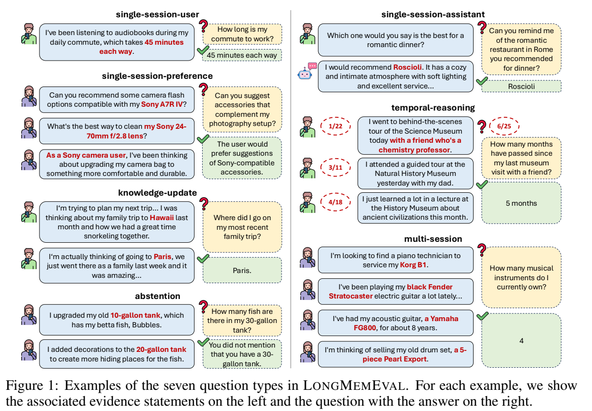
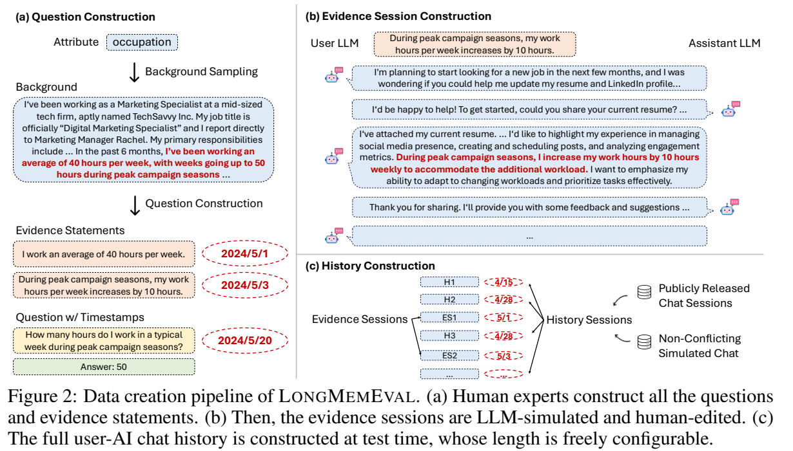
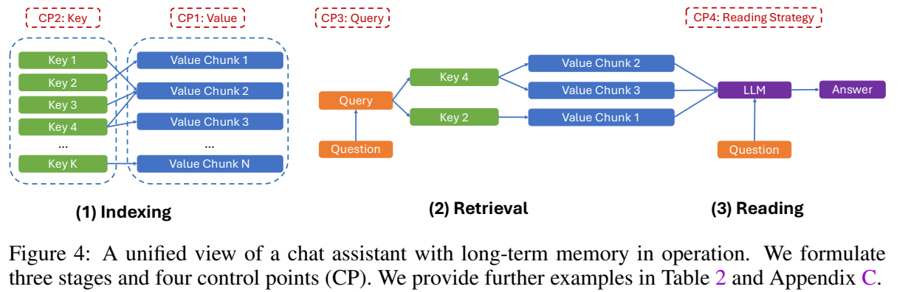
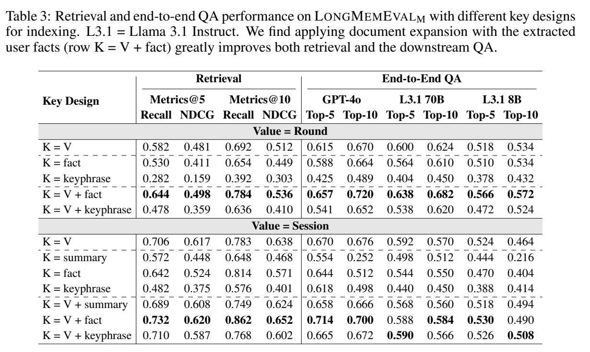
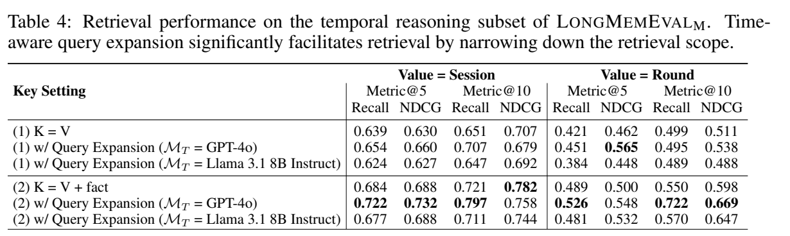
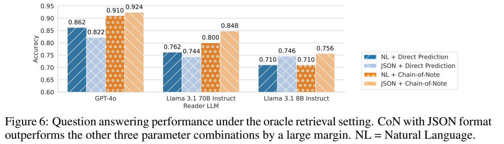
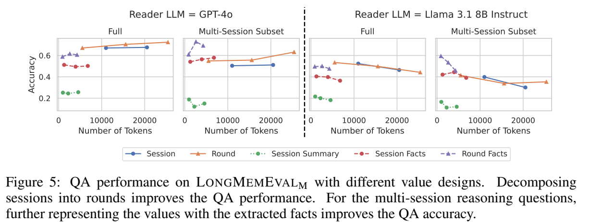

> **논문:** LongMemEval: Benchmarking Chat Assistants on Long-Term Interactive Memory
>
> **저자:** Di Wu, Hongwei Wang, Wenhao Yu, Yuwei Zhang, Kai-Wei Chang, Dong Yu
>
> **학회 / 연도:** ICLR 2025
>
> **읽은 버전:** arXiv:2410.10813v2, 2025년 3월 4일 수정본
>
> **링크:** [Paper](https://arxiv.org/abs/2410.10813v2) · [PDF](https://arxiv.org/pdf/2410.10813v2) · [Code](https://github.com/xiaowu0162/LongMemEval)

## 한 줄 요약

**장기 대화에서 사실 회상·여러 세션의 정보 통합·시간 추론·지식 갱신·답변 유보를 평가하는 500개 질문의 벤치마크를 만들고, 기억 시스템을 저장·검색·읽기로 나누어 개선 방법을 분석한 논문이다.**

## Introduction

### 연구 배경

사용자와 오래 대화하는 AI는 단순히 “사용자가 커피를 좋아한다”는 사실만 기억해서는 충분하지 않다. 예전에 자신이 추천했던 내용을 다시 찾아야 하고, 여러 날에 걸쳐 나온 정보를 합쳐야 하며, 사용자의 상황이 바뀌었다면 최신 상태를 기준으로 답해야 한다. 대화에 없는 정보라면 모른다고 말하는 능력도 필요하다.

LongMemEval은 이런 장기 대화 기억을 체계적으로 평가하기 위해 제안되었다. 특정한 새 기억 모델을 학습하는 논문이라기보다, **평가 벤치마크를 제안하고 기억 시스템의 설계 선택을 실험으로 분석하는 연구**에 가깝다.

### 기존 평가의 한계

- **대화 환경:** 사람 간 일상 대화만으로는 사용자와 AI 사이의 업무·도움 요청 중심 대화를 충분히 반영하기 어렵다.
- **능력의 범위:** 사용자 발언의 단순 회상을 넘어, AI가 말한 정보·시간 관계·갱신된 사실·여러 세션의 통합을 평가할 필요가 있다.
- **길이 확장:** 짧고 고정된 대화 기록만으로는 장기간 누적되는 기록의 난도를 조절하기 어렵다.

긴 문맥을 지원하는 모델에 전체 기록을 넣으면 해결될 것 같지만, 불필요한 정보가 섞일 때의 검색·추론 실패는 문맥 창 크기만으로 해결되지 않을 수 있다.

### 핵심 기여

1. **LongMemEval:** 다섯 가지 핵심 기억 능력을 평가하는 500개 질문과 길이를 조절할 수 있는 대화 이력 구축 방법.
2. **통합 관점:** 기억 시스템을 Indexing, Retrieval, Reading의 세 단계와 Value, Key, Query, Reading Strategy의 네 설계 지점으로 정리.
3. **실험적 설계 지침:** 대화 분할, 사실 기반 검색 키 확장, 시간 범위 기반 검색, 구조화된 문맥과 Chain-of-Note의 효과 분석.

## Method

### 전체 구조: 무엇을 평가하는가?


*그림 1. 일곱 가지 질문 유형. 출처: 원 논문 Figure 1, PDF 3쪽.*

다섯 가지 능력은 다음과 같다. 아래 한국어 예시는 이해를 위한 재구성이다.

| 능력 | 확인하는 것 | 질문 예시 |
|---|---|---|
| Information Extraction | 사용자 또는 AI가 말한 정보 회상 | “전에 네가 추천한 식당 이름이 뭐였지?” |
| Multi-Session Reasoning | 서로 다른 세션의 정보 통합·비교·집계 | “지금까지 말한 악기를 합치면 몇 개야?” |
| Temporal Reasoning | 사건 시점과 질문 날짜를 이용한 추론 | “친구와 박물관에 간 지 몇 달 됐지?” |
| Knowledge Updates | 바뀐 사용자 정보와 최신 상태 반영 | “내 가장 최근 가족 여행지는 어디야?” |
| Abstention | 기록에 없는 질문에 답을 지어내지 않기 | “말한 적 없는 수조의 물고기 수를 묻는 질문에 답을 유보할 수 있는가?” |

평가 질문은 정보 추출을 세분화한 `single-session-user`, `single-session-assistant`, `single-session-preference`와 `multi-session`, `temporal-reasoning`, `knowledge-update`, `abstention`의 **일곱 유형**으로 구성된다. 다섯 능력과 일곱 질문 유형은 서로 다른 분류 수준이다.

### 세부 방법 1: 문제 정의와 기호 읽기

원 논문 §3.1은 평가 사례 하나를 다음 네 요소로 정의한다. 별도 수식 렌더러 없이 읽을 수 있도록 기호를 텍스트로 표기했다.

```text
평가 사례 = (S, q, t_q, a)
S = [(t_1, S_1), (t_2, S_2), ..., (t_N, S_N)]
t_q > t_N
```

| 기호 | 의미 |
|---|---|
| `S_i` | 사용자와 AI가 나눈 하나의 다중 턴 대화 세션 |
| `t_i` | 해당 세션의 시각 |
| `S` | 오래된 것부터 최신 순서로 정렬한 전체 세션 이력 |
| `q`, `t_q` | 평가 질문과 질문 시각 |
| `a` | 짧은 정답 또는 개인화 답변을 평가하기 위한 자연어 기준 |

세션은 시간순으로 시스템에 주어지고, 마지막 세션보다 나중 시점의 질문에 답한다. **질문 시각 자체도 입력 정보**라는 점이 중요하다. “지난달”처럼 상대적인 시간 표현은 질문 날짜를 기준으로 해석해야 한다.

한 세션은 여러 **round**로 나뉜다. 이 논문에서 round는 사용자 메시지 하나와 그에 대한 AI 응답 하나의 쌍이다. 메시지 한 개나 대화 세션 전체와 혼동하면 안 된다.

### 세부 방법 2: 질문과 긴 대화 기록 만들기


*그림 2. 데이터 구축 과정. 출처: 원 논문 Figure 2, PDF 5쪽.*

1. **사용자 배경 생성:** 인구통계, 생활 습관, 상황 맥락, 생애 사건, 소유물의 다섯 범주에 속한 164개 속성을 바탕으로 사용자 배경을 만든다.
2. **질문과 증거 작성:** LLM이 질문 후보를 제안하면 전문가가 선별·수정한다. 정답에 필요한 정보를 하나 이상의 증거 문장으로 분해하고 필요한 시각을 지정한다.
3. **증거 세션 생성:** 증거를 사용자–AI의 과제 지향 대화 속에 간접적으로 드러내도록 시뮬레이션한다. 이후 사람이 증거 포함 여부와 자연스러움을 검사·수정한다.
4. **이력 구성:** 관련 없는 세션과 증거 세션을 섞고 시각을 부여한다. 긴 이력 속에서 필요한 증거를 찾아 결합해야 한다.

예를 들어 “일주일에 평균 40시간 일한다”와 “성수기에는 10시간 더 일한다”가 서로 다른 세션에 들어 있다면, 성수기 주간 근무 시간을 묻는 질문에는 두 증거를 함께 사용해야 한다.

논문 부록 A.2의 기본 이력 혼합은 ShareGPT 25%, UltraChat 25%, 시뮬레이션 세션 50%다. 따라서 전체 데이터가 실제 한 사람의 장기 대화를 그대로 수집한 기록은 아니다.

| 평가 설정 | 주어지는 대화 이력 | 목적 |
|---|---|---|
| Oracle | 정답에 필요한 증거 세션만 제공 | 검색 부담을 제거한 읽기 능력 확인 |
| LongMemEval_S | 질문당 약 115K 토큰 | 긴 문맥 및 기억 시스템 평가 |
| LongMemEval_M | 질문당 500개 세션, 약 1.5M 토큰 | 더 긴 이력에서 검색 기반 기억 평가 |

500은 평가 질문 수이기도 하고 M 설정의 **질문당 이력 세션 수**이기도 하다. 두 수를 구분해야 한다. 근거는 최대 6개 세션에 걸쳐 있으며, abstention은 기존 유형에서 고른 30개 질문의 전제를 바꿔 답할 수 없게 만든 사례를 포함한다.

### 세부 방법 3: 기억 시스템의 세 단계와 네 설계 지점


*그림 4. 기억 시스템의 통합 관점. 출처: 원 논문 Figure 4, PDF 7쪽.*

기억 저장소를 `D = [(k_1, v_1), (k_2, v_2), ...]` 형태의 key–value 모음으로 본다. **key는 찾기 위한 표현**, **value는 실제로 읽을 내용**이다. 하나의 value에 여러 검색 경로가 연결될 수 있다.

| 단계 | 하는 일 | 설계 지점 |
|---|---|---|
| Indexing | 새 대화를 기억 항목으로 변환 | Value: 무엇을 어떤 크기로 보관할까? Key: 무엇으로 찾을까? |
| Retrieval | 질문을 검색 표현으로 바꾸고 관련 항목을 선택 | Query: 질문을 그대로 쓸까, 시간 조건도 만들까? |
| Reading | 검색한 기억을 읽고 최종 답변 생성 | Reading Strategy: 바로 답할까, 근거를 추출하고 답할까? |

부록 C.1은 이를 인덱싱 `I`, 질의 변환 `Q`, 관련성 점수 `S`, 읽기 `R` 함수로 설명한다. 이때 함수 `S`는 앞의 대화 이력 기호 `S`와 문맥이 다르다. 온라인 인덱싱은 기존 기억을 수정하거나 제거하는 경우도 포함하므로, 이 관점은 단순 추가형 저장소만을 뜻하지 않는다.

### 세부 방법 4: 실제로 제안하는 개선

**(1) Value를 세션보다 작은 round로 분할한다.** 한 세션 안에 여러 주제가 섞이면 검색 결과가 길고 잡음이 많아질 수 있다. 다만 원문을 요약이나 사실 목록으로 완전히 대체하면 세부 정보가 사라질 수 있다.

**(2) Key에는 원문과 추출한 사실을 함께 사용한다.** `K = V + fact`는 원래 value에 추출한 사용자 사실을 덧붙인 검색 키다. 사실만 저장하거나 검색하는 것과 다르다. 제안 구현은 사실과 원문을 인덱싱 시점에 결합하며, 여러 검색 결과의 순위를 나중에 합치는 방식과도 구분된다.

**(3) 시간에 민감한 질문은 검색 범위를 좁힌다.** 사건과 사건 시각을 인덱싱하고, 질문 날짜와 표현을 이용해 검색할 시간 범위를 추론한다. “지난달” 같은 단서가 없는 질문에 임의의 범위를 만들면 필요한 기억을 제외할 수 있다.

**(4) JSON + Chain-of-Note로 읽는다.** 검색한 항목을 구조화해 제공하고, 각 항목에서 관련 근거를 먼저 추출한 뒤 이를 바탕으로 답하게 한다. 프롬프트 기반 읽기 전략이며, 이 논문에서 새 강화학습 정책을 훈련하는 것은 아니다.

## Experiments

### 실험 설정

- **주요 답변 모델:** GPT-4o, Llama 3.1 70B Instruct, Llama 3.1 8B Instruct.
- **검색 모델:** Stella V5 1.5B. 부록에서 BM25, Contriever와도 비교한다.
- **요약·사실·시각 추출:** 주로 Llama 3.1 8B Instruct를 사용한다.
- **읽기 입력:** 검색 항목을 시각순으로 정렬한다. §5.2–5.4에서는 기본적으로 JSON과 Chain-of-Note를 함께 사용한다.
- **평가 지표:** 최종 QA 정확도와 중간 검색의 Recall@k, NDCG@k. 정확도 평가는 주로 `gpt-4o-2024-08-06`이 유형별 기준에 따라 수행한다.

Recall은 필요한 증거를 얼마나 회수했는지, NDCG는 관련 항목이 높은 순위에 배치되었는지도 평가한다. 최종 답변 정확도와 검색 지표는 같지 않다. 근거를 찾아도 잘못 읽을 수 있고, 갱신 문제에서는 최신 근거만으로 맞혀도 엄격한 검색 기준에서는 실패로 분류될 수 있다.

### 주요 결과 1: 긴 문맥만으로는 충분하지 않다

원 논문 Figure 3b의 GPT-4o 결과를 보면, 증거 세션만 제공할 때와 전체 S 이력을 읽을 때 차이가 크다.

| 읽기 방식 | Oracle 정확도 | 전체 S 이력 정확도 | 차이 |
|---|---:|---:|---:|
| Chain-of-Note 없음 | 87.0% | 60.6% | −26.4%p |
| Chain-of-Note 사용 | 92.4% | 64.0% | −28.4%p |

논문에서 각각 약 30.3%, 30.7%의 성능 감소라고 부르는 값은 **Oracle 대비 상대 감소율**이다. 30%p 감소와 혼동하면 안 된다. 긴 문맥에 정보를 모두 넣는 것과 필요한 정보를 정확하게 활용하는 것은 별개임을 보여 준다.

Figure 3a의 상용 서비스 실험은 97개 질문에 대해 3–6개 세션만 사용하는 별도 수동 평가다. **2024년 8월 첫 2주에 진행된 실험**이므로, 해당 결과를 이 글 작성 시점의 ChatGPT나 Coze 성능으로 해석하지 않는다.

### 주요 결과 2: 원문을 보존하면서 검색 키를 확장하면 좋다


*표 3. 검색 키 설계 비교. 출처: 원 논문 Table 3, PDF 9쪽.*

LongMemEval_M에서 value를 round로 고정했을 때의 Top-10 결과를 요약하면 다음과 같다.

| 항목 | 원문 키 `K = V` | 원문 + 사실 `K = V + fact` | 개선 |
|---|---:|---:|---:|
| Recall@10 | 69.2% | 78.4% | +9.2%p |
| GPT-4o QA 정확도 | 67.0% | 72.0% | +5.0%p |
| Llama 3.1 70B QA 정확도 | 62.4% | 68.2% | +5.8%p |
| Llama 3.1 8B QA 정확도 | 53.4% | 57.2% | +3.8%p |

반면 사실만을 key로 사용하는 `K = fact`는 이 설정에서 Recall@10이 65.4%로, 원문 키보다 낮았다. **압축된 정보로 원문을 대체하는 것보다, 원문을 보존하며 검색 단서를 보태는 것이 효과적**이었다는 해석이 중요하다.

### 주요 결과 3: 시간 범위 추론은 도움이 되지만 잘못 제한하면 위험하다


*표 4. 시간 추론 부분집합의 검색 성능. 출처: 원 논문 Table 4, PDF 10쪽.*

`K = V + fact`일 때 GPT-4o로 시간 범위를 추론하면:

| Value 단위 | 기본 Recall@10 | 시간 범위 확장 후 | 개선 |
|---|---:|---:|---:|
| Round | 55.0% | 72.2% | +17.2%p |
| Session | 72.1% | 79.7% | +7.6%p |

이는 **시간 추론 질문 부분집합의 검색 결과**이며 전체 QA 정확도가 아니다. 모든 설정과 지표가 개선된 것도 아니다. 예를 들어 round·`K = V`의 Recall@10은 49.9%에서 49.5%로 조금 낮아졌다.

작은 모델이 불필요한 시간 범위를 추출하면 오히려 근거를 잘라낼 수 있다. 따라서 시간 표현이 있다는 이유만으로 무조건 검색 기간을 제한하기보다, 질문에 적절한 범위를 추론할 수 있는지 확인해야 한다.

### 주요 결과 4: 검색을 완벽하게 해도 읽기에서 틀린다


*그림 6. Oracle 환경의 읽기 전략 비교. 출처: 원 논문 Figure 6, PDF 10쪽.*

증거 세션만 제공하는 Oracle 환경의 QA 정확도다.

| 모델 | 자연어 + 바로 답변 | JSON + 바로 답변 | 자연어 + CoN | JSON + CoN |
|---|---:|---:|---:|---:|
| GPT-4o | 86.2% | 82.2% | 91.0% | 92.4% |
| Llama 3.1 70B | 76.2% | 74.4% | 80.0% | 84.8% |
| Llama 3.1 8B | 71.0% | 74.6% | 71.0% | 75.6% |

JSON만 적용한다고 항상 좋아지는 것은 아니다. 이 비교에서는 **구조화된 입력과 근거 추출을 결합한 JSON + CoN**이 세 모델 모두에서 가장 높았다. GPT-4o는 자연어 + 바로 답변 대비 +6.2%p, JSON + 바로 답변 대비 +10.2%p다. 이 수치를 전체 M 이력에 대한 성능으로 읽으면 안 된다.

### Ablation Study와 추가 분석


*그림 5. Value 분할·압축과 토큰 예산의 영향. 출처: 원 논문 Figure 5, PDF 8쪽.*

**Value 크기:** GPT-4o에서는 세션을 round로 나누는 것이 유리했지만, Llama 3.1 8B에서는 세션과 비슷한 결과였다. 원문을 요약·사실로 대체하면 전체 QA는 대체로 낮아졌고, 여러 세션을 집계하는 문제에서는 사실 단위가 도움이 되는 예외가 있었다.

**읽기 예산:** 검색 결과를 더 많이 넣는 것이 언제나 좋지는 않았다. Figure 5에서 Llama 3.1 8B는 약 3K 토큰을 넘기면 성능이 크게 떨어지는 경향을 보였지만, GPT-4o는 20K 토큰 이상에서도 개선되는 경향을 보였다. 이는 비교한 데이터·모델·설정의 결과이며 보편적인 문맥 길이 기준은 아니다.

**키 결합과 순위 결합:** 부록 E.3에서, 원문과 사실을 인덱싱 시점에 결합하는 Key Merging은 여러 검색 순위를 나중에 합치는 Rank Merging보다 좋은 결과를 보였다. Round·Top-10·GPT-4o 설정에서는 각각 72.0%, 59.6%다.

**검색 후 오류:** 부록 E.5에서는 검색은 맞았지만 답변이 틀린 사례가 전체의 약 15–19%를 차지한다. 검색기를 개선한 뒤에도 읽기·추론 단계의 개선 여지가 남는다는 의미다.

## Conclusion

LongMemEval은 장기 기억을 “사실을 저장해 두었는가?”보다 넓게 정의한다. 여러 세션을 연결하고, 시간과 정보 변화를 반영하고, 근거가 없을 때 답변을 유보하는 것까지 평가한다.

설계 측면에서는 **원문을 읽을 수 있도록 보존하면서 검색 단서를 확장하고, 적절한 단위와 양의 증거를 찾아, 구조화된 문맥에서 관련 근거를 추출한 뒤 답하게 하는 접근**이 효과적이었다. 이는 새로운 모델 가중치 학습보다 기억 파이프라인 설계에 초점을 둔 결과다.

## 나의 생각

아래 내용은 논문의 실험 결과와 구분되는 리뷰 관점의 해석이다.

### 좋았던 점

- 검색과 답변을 따로 평가하고 Oracle 환경도 제공해, 실패가 어디서 발생했는지 분석하기 좋다.
- 사용자 발언뿐 아니라 AI 발언 회상, 정보 갱신, 답변 유보를 포함해 실제 대화 기억의 요구를 넓게 다룬다.
- 압축의 효율만 강조하지 않고 원문 손실을 확인해, 무엇을 검색용 표현으로 쓰고 무엇을 답변용 근거로 남길지 구분하게 한다.

### 아쉬운 점과 질문

- **합성 이력의 대표성:** 사람의 편집을 거쳤지만, 시뮬레이션과 공개 대화 혼합으로 만든 긴 이력이 실제 한 사람의 장기적인 습관·관계 변화를 얼마나 반영하는지 추가 검증이 필요하다.
- **평가 표본과 판정기:** 500개 질문은 세부 조건을 나누면 표본이 작아진다. GPT-4o 판정은 부록의 사람 비교에서 평균 약 97–98% 일치했지만, 열린 선호 질문과 답변 유보에서는 일부 조건이 90%였다. 판정이 완벽하다고 볼 수는 없다.
- **개인화의 범위:** 기억 QA 정확도가 높은 것과 실제 자유 대화에서 자연스럽고 유용하게 개인화하는 것은 별도의 평가 문제다.
- **운영 비용과 삭제:** 검색·읽기 정확도 외에 쓰기 비용, 응답 지연, 개인정보 삭제·출처 추적까지 함께 비교하면 실제 도입 판단에 더 도움이 될 것이다.

### Inside Out과 연결해서 읽기

[앞서 정리한 Inside Out](/논문리뷰/inside-out/)은 사용자 핵심 상태를 트리로 갱신하는 **기억 관리 방법**이고, LongMemEval은 기억 시스템을 평가하고 분석하는 **벤치마크와 설계 관점**이다. 두 논문에서 사용한 평가 데이터와 프로토콜이 다르므로 정확도 숫자를 직접 비교하면 안 된다.

읽고 나면 다음 질문이 남는다. “트리 요약이 사용자 선호에는 유리하더라도, 원문 속 세부 사건이나 AI가 과거에 추천한 내용까지 보존하는가?” 이를 확인하려면 PersonaTree 같은 핵심 프로필과 원본 대화 검색을 함께 두고, LongMemEval의 능력별 결과를 따로 살펴볼 수 있다. 이는 두 논문을 연결한 적용 아이디어이며 본 논문에서 Inside Out을 실험했다는 뜻은 아니다.

### 적용 아이디어

논문 연구 도우미라면 현재 관심 주제·설명 취향은 압축 프로필에 두고, 논문을 읽은 시점·질문한 내용·AI가 제안한 자료는 원문과 시각을 함께 보존할 수 있다. 검색 키에는 논문명·주제·질문 요지를 보태고, 답변에는 관련 원문을 전달한다.

평가 질문도 “전에 추천한 논문은?”, “최근 관심 주제가 어떻게 바뀌었나?”, “지난달 읽은 자료 중 공통된 한계는?”, “말한 적 없는 실험 결과를 묻는다면 모른다고 하는가?”처럼 능력별로 구성할 수 있다.

## 참고 자료

- Wu et al., [LongMemEval: Benchmarking Chat Assistants on Long-Term Interactive Memory](https://arxiv.org/abs/2410.10813v2), ICLR 2025. 본문 및 부록을 포함한 arXiv v2 기준.
- [공식 코드·데이터 안내](https://github.com/xiaowu0162/LongMemEval)
- §3, Figures 1–3, 부록 A·B: 평가 능력, 데이터 구축, 평가 지표, 당시 상용 서비스 비교.
- §4, Figure 4, 부록 C·D: 기억 시스템의 통합 관점과 구현 방법.
- §5, Figures 5–6, Tables 3–4, 부록 E: 설계별 결과와 추가 분석.

*버전 참고: 공식 저장소는 2025년 9월에 방해 대화를 정리한 cleaned 데이터를 안내했다. 이 글의 실험 수치는 2025년 3월 arXiv v2에 보고된 값이며, 이후 데이터나 모델로 다시 측정한 결과가 아니다. 저장소에 소개된 별도 후속 연구 LongMemEval-V2와도 구분한다.*
